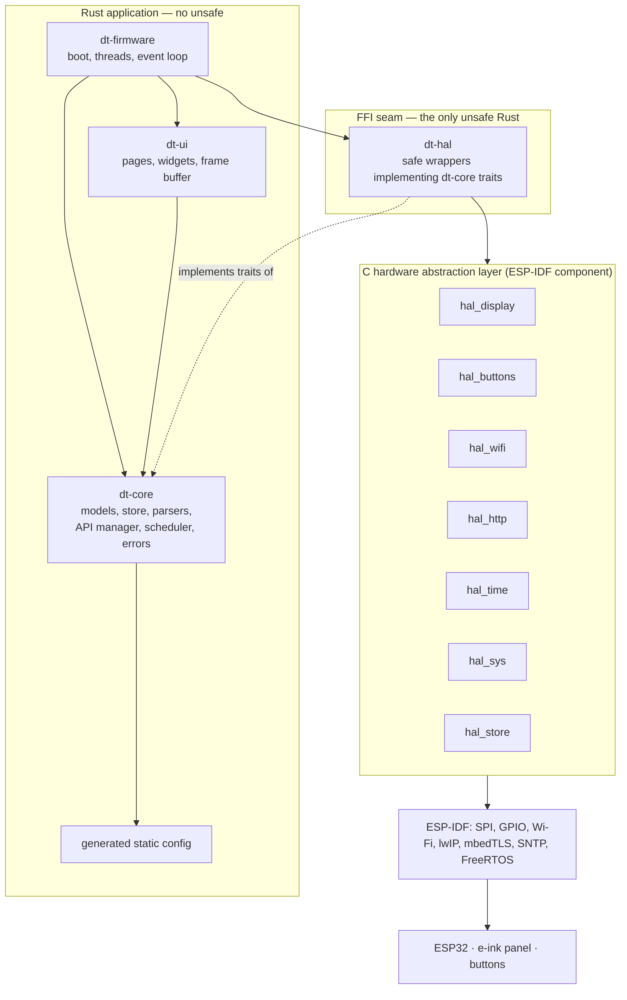
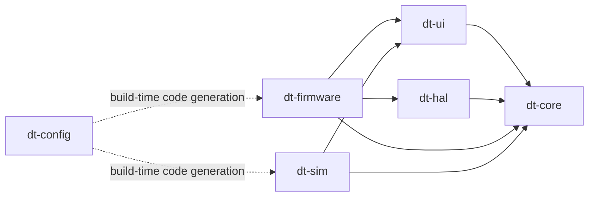
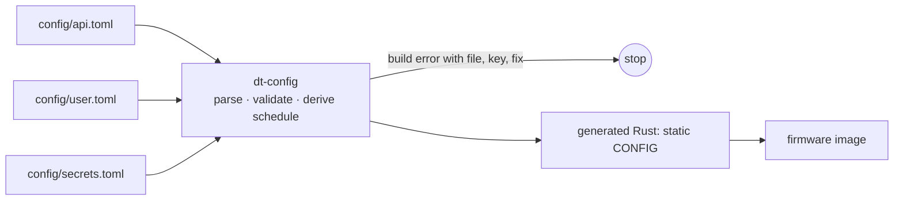
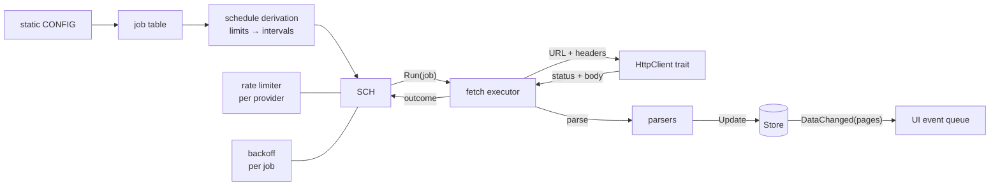
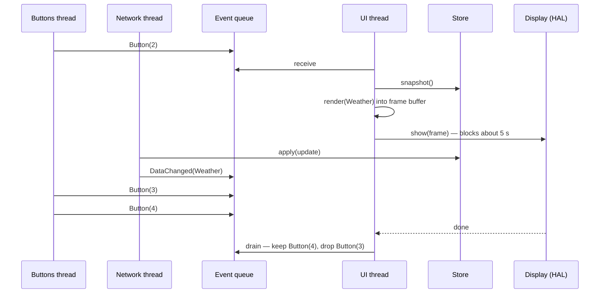

# ESP32 Desktop Terminal — Architecture

| | |
|---|---|
| Status | Draft v0.2 |
| Date | 2026-11-17 |
| Related | [Requirements](Requirements.md) · [Implementation Plan](ImplementationPlan.md) |

## 1. Overview

The firmware is a Rust application running on ESP-IDF (FreeRTOS, `std`
available), on top of a hardware abstraction layer written in C as an ESP-IDF
component.

Three ideas shape everything else:

1. **One seam between Rust and C.** Everything that touches hardware or the
   ESP-IDF SDK (display, buttons, Wi-Fi, HTTPS, time, persistent storage, system services) is behind
   the C HAL. Exactly one Rust crate wraps it, and that crate is the only place
   `unsafe` is allowed (REQ-LANG-02, REQ-LANG-03).
2. **A pure core.** Models, parsers, the scheduler and all rendering depend on
   traits, not on the HAL. They compile and run on a PC, where they are unit
   tested and rendered to PNG (REQ-TEST-01, REQ-TEST-02).
3. **One-way data flow.** The API manager writes the data store; pages only
   read a snapshot of it (REQ-API-01, REQ-DM-01).



## 2. Key decisions

| # | Decision | Why | Alternative rejected |
|---|---|---|---|
| D-1 | Rust `std` on ESP-IDF, built by Cargo through `esp-idf-sys`. | Gives threads, channels, `serde_json`, and ESP-IDF's Wi-Fi and TLS stack. The C HAL plugs in as an "extra component" and gets bindings generated by `bindgen`. | Bare-metal `esp-hal` (`no_std`): no ESP-IDF, so the C HAL would have nothing to stand on. CMake-led project with Rust as a static library: more build glue for no gain. |
| D-2 | The C HAL covers platform services (Wi-Fi, HTTPS, SNTP), not just the display and buttons. | Keeps a single FFI seam and avoids depending on third-party Rust wrappers around the same SDK calls. Follows "C is the hardware abstraction layer" literally. | Using `esp-idf-svc` for networking: less C to write, but two seams and a larger dependency surface. Worth revisiting if the C networking code becomes a burden. |
| D-3 | The HAL API is blocking and poll-based. C never calls Rust; buffers are owned by the caller. | No callbacks or shared ownership across FFI means the unsafe wrapper stays tiny and easy to audit (REQ-LANG-04). | Callback-based events: needs `extern "C"` Rust functions and lifetime reasoning across the boundary. |
| D-4 | Configuration is validated and compiled into the firmware at build time. | Config mistakes become build errors instead of device faults; no TOML parser or filesystem on the device (REQ-CFG-06, REQ-ERR-02). | Config on a flash filesystem: flexible, but a bad file is a runtime failure. |
| D-5 | Rendering is done in Rust into a 1-bit frame buffer with `embedded-graphics`; the HAL only pushes finished frames. | Layout code is host-testable and the display driver stays small. | Drawing primitives in C: untestable on a PC and duplicates work. |
| D-6 | One network thread, one request at a time. | Bounds memory to a single TLS session (REQ-PERF-02). Request rates are far too low to need parallelism. | A thread per provider. |
| D-7 | Full refresh only in v1. | Works on every revision of the panel; partial refresh support is revision-dependent and is evaluated later (plan task J04). | Partial refresh from day one. |
| D-8 | No OTA; one large application partition. | Simplest layout, most room for the image, and the device is always recoverable over USB (REQ-ERR-08). | Dual OTA slots halve the available space on 4 MB flash. |

## 3. Repository layout

```
ESP32-DesktopTerminal/
├── Cargo.toml                 host workspace (stable Rust): crates/*
├── firmware/                  device workspace (esp Rust toolchain)
│   ├── Cargo.toml             workspace: dt-hal, dt-firmware
│   ├── rust-toolchain.toml    esp (Xtensa) toolchain
│   ├── .cargo/config.toml     target, runner, ESP-IDF version pin
│   ├── sdkconfig.defaults     ESP-IDF options
│   ├── partitions.csv
│   ├── dt-hal/                FFI bindings + safe wrappers (only crate with unsafe)
│   └── dt-firmware/           the binary: boot, threads, event loop
├── config/
│   ├── api.toml               URLs, limits, polling floors      (committed)
│   ├── user.example.toml      topics, symbols, location         (template)
│   ├── user.toml              real preferences                  (git-ignored)
│   ├── secrets.example.toml   API keys, Wi-Fi                   (template)
│   └── secrets.toml           real secrets                      (git- and AI-ignored)
├── hal/                       C HAL
│   └── dt_hal/                ESP-IDF component (ESP-IDF already has one named "hal")
│       ├── CMakeLists.txt
│       ├── include/           hal.h (umbrella, bindgen input), hal_err.h, hal_pins.h, ...
│       └── src/
├── crates/
│   ├── dt-config/             config schema, validation, code generation (host)
│   ├── dt-core/               models, store, parsers, API manager, traits, errors
│   ├── dt-ui/                 frame buffer, fonts, icons, widgets, pages
│   └── dt-sim/                host simulator: pages → PNG, golden tests
├── assets/                    icon and font sources
└── docs/
```

There are two Cargo workspaces because the two halves need different
toolchains. The host crates build and test with stable Rust on a PC; the
firmware crates need the `esp` Xtensa toolchain and a cross-compilation target.
A single workspace would force the `esp` toolchain and the device target onto
every host build and test. The firmware workspace depends on the host crates by
path, so there is still one copy of every crate.

Crate dependencies point one way:



`dt-core` and `dt-ui` carry `#![forbid(unsafe_code)]` and have no ESP-specific
dependencies.

## 4. The C HAL

An ESP-IDF component, `dt_hal`, in `hal/dt_hal/`. `dt-hal`'s `Cargo.toml`
declares it under `package.metadata.esp-idf-sys.extra_components`, so
`esp-idf-sys` compiles it with ESP-IDF and runs `hal.h` through `bindgen` into
the module `esp_idf_sys::dt_hal`. Two details matter (proven in plan task A06):

- `esp-idf-sys` only reads extra components from the root crate and its direct
  dependencies. The firmware workspace is virtual, so
  `ESP_IDF_SYS_ROOT_CRATE = "dt-firmware"` is set in
  `firmware/.cargo/config.toml`, and `dt-firmware` depends on `dt-hal`
  directly.
- `esp-idf-sys` re-runs the ESP-IDF build only for files it tracks, and by
  default that is just `hal.h`. `firmware/.cargo/config.toml` adds every
  `.c`, `.h` and `CMakeLists.txt` under `hal/dt_hal` through its
  `ESP_IDF_GLOB_HAL_*` settings, so editing any HAL file rebuilds it.

### 4.1 Rules

- Every function returns `hal_err_t`. Results come back through out-parameters.
- All calls block, with an explicit timeout wherever they can wait.
- The caller allocates every buffer. No heap pointer crosses the boundary in
  either direction.
- No callbacks into Rust.
- Each module documents which threads may call it. Each module serialises its
  own hardware access.
- Runtime paths never abort. `ESP_ERROR_CHECK` is not used outside one-time
  initialisation that cannot fail on working hardware.
- Pin numbers live only in `hal_pins.h` (REQ-MAINT-01). It also records the pins that must stay untouched: GPIO0, 2, 4 and 12 (REQ-HW-06).

### 4.2 Interface sketch

```c
/* hal_err.h */
typedef enum {
    HAL_OK = 0,
    HAL_ERR_INVALID_ARG, HAL_ERR_NOT_INIT, HAL_ERR_NO_MEM,
    HAL_ERR_TIMEOUT, HAL_ERR_IO,
    HAL_ERR_WIFI_AUTH, HAL_ERR_WIFI_NO_AP, HAL_ERR_WIFI_DISCONNECTED,
    HAL_ERR_DNS, HAL_ERR_CONNECT, HAL_ERR_TLS, HAL_ERR_HTTP_TOO_LARGE,
    HAL_ERR_INTERNAL,
} hal_err_t;
const char *hal_err_str(hal_err_t err);

/* hal_display.h — 800x480, 1 bit per pixel, 48 000-byte frame */
hal_err_t hal_display_init(void);
hal_err_t hal_display_show(const uint8_t *frame, size_t len); /* wake, full refresh, sleep */
hal_err_t hal_display_clear(void);
hal_err_t hal_display_sleep(void);

/* hal_buttons.h */
typedef enum { HAL_BTN_PRESS, HAL_BTN_LONG_PRESS } hal_button_action_t;
typedef struct { uint8_t id; hal_button_action_t action; } hal_button_event_t;
hal_err_t hal_buttons_init(void);
hal_err_t hal_buttons_wait(hal_button_event_t *out, uint32_t timeout_ms);

/* hal_wifi.h */
typedef struct { hal_wifi_state_t state; int8_t rssi; uint32_t ipv4; hal_err_t last_error; } hal_wifi_status_t;
hal_err_t hal_wifi_start(const char *ssid, const char *password);
hal_err_t hal_wifi_status(hal_wifi_status_t *out);
hal_err_t hal_wifi_wait_connected(uint32_t timeout_ms);

/* hal_http.h — HTTPS GET with the ESP-IDF certificate bundle */
typedef struct { const char *name; const char *value; } hal_http_header_t;
typedef struct { const char *url; const hal_http_header_t *headers; size_t header_count; uint32_t timeout_ms; } hal_http_request_t;
typedef struct { int status; size_t body_len; bool truncated; int32_t retry_after_s; } hal_http_response_t;
hal_err_t hal_http_get(const hal_http_request_t *req, uint8_t *body, size_t body_cap, hal_http_response_t *resp);

/* hal_time.h */
hal_err_t hal_time_start_sync(const char *posix_tz);
bool      hal_time_is_synced(void);
hal_err_t hal_time_now(int64_t *unix_seconds);
hal_err_t hal_time_utc_offset(int64_t unix_seconds, int32_t *offset_seconds);

/* hal_sys.h */
uint64_t  hal_sys_uptime_ms(void);
hal_err_t hal_sys_heap(uint32_t *free_bytes, uint32_t *min_free_bytes);
hal_reset_reason_t hal_sys_reset_reason(void);
void      hal_sys_restart(void);
hal_err_t hal_sys_wdt_register(uint32_t timeout_ms);
hal_err_t hal_sys_wdt_feed(void);
hal_err_t hal_sys_retained_read(uint8_t *buf, size_t len);   /* survives soft reset */
hal_err_t hal_sys_retained_write(const uint8_t *buf, size_t len);

/* hal_store.h — small named blobs in NVS flash; survive power loss */
hal_err_t hal_store_get(const char *key, uint8_t *buf, size_t cap, size_t *len);
hal_err_t hal_store_set(const char *key, const uint8_t *buf, size_t len);
```

### 4.3 Module notes

| Module | Notes |
|---|---|
| `hal_display` | SPI on the pins in `Pins.md`. Reset, init sequence, frame transfer, refresh, then deep sleep on every `show` (REQ-DISP-01). Every wait on BUSY has a timeout that returns `HAL_ERR_TIMEOUT`; the next call re-initialises the panel. |
| `hal_buttons` | GPIO16–19, active-low inputs with internal pull-ups. GPIO interrupt → debounce → FreeRTOS queue. Distinguishes press from long press. |
| `hal_wifi` | Station mode. Reconnects by itself with backoff, forever. Reports the reason for a failure (wrong password vs. network not found) so the UI can say something useful. |
| `hal_http` | `esp_http_client` with the certificate bundle. Reports truncation instead of overflowing. Captures `Retry-After`. Never logs the URL (it may contain a key). |
| `hal_time` | SNTP and time zone. Until the first sync, `hal_time_is_synced` is false and the UI hides clock-dependent text. |
| `hal_sys` | Heap statistics, reset reason, task watchdog, and a small CRC-protected block of RTC memory that survives software resets (crash counter). |
| `hal_store` | Named blobs in NVS, for state that must survive power loss (API call counts). A missing or corrupt entry reads as empty, never as an error that stops boot. |

## 5. Rust crates

### 5.1 `dt-hal` — the FFI seam

Wraps each HAL module in a safe type that implements a `dt-core` trait:

| Trait (`dt-core::platform`) | Implemented by | Purpose |
|---|---|---|
| `Display` | `EinkDisplay` | Show a frame, clear, sleep |
| `Buttons` | `HalButtons` | Wait for the next button event |
| `Wifi` | `HalWifi` | Start, status, wait for connection |
| `HttpClient` | `HalHttp` | GET into a caller buffer |
| `Clock` | `HalClock` | Monotonic time, wall-clock time, UTC offset |
| `System` | `HalSystem` | Heap, reset reason, restart, watchdog, retained memory |
| `Storage` | `HalStore` | Named blobs that survive power loss |

Every `unsafe` block carries a `SAFETY:` comment. CI fails if `unsafe` appears
in any other crate.

### 5.2 `dt-core` — models, store, API manager

**Errors.** One `AppError` type: a stable code, a category, a message, and a
hint telling the user what to do. See §9.

**Models** are provider-neutral (REQ-DM-03) and always metric; conversion to
the user's units happens when formatting. Current conditions and the forecast
are separate models because they come from separate endpoints and refresh on
different schedules.

```rust
pub struct Current  { /* temperature, feels-like, condition, humidity, wind, sunrise, sunset */ }
pub struct Forecast { pub hourly: Vec<HourlyPoint>, pub daily: Vec<DailySummary> }
pub struct NewsTopic { pub title: String, pub headlines: Vec<Headline> }
pub struct Quote    { pub label: String, pub symbol: String, pub price: f32, pub change: f32,
                      pub change_pct: f32, pub day_low: f32, pub day_high: f32, pub history: History }
```

**Store.** Every model lives in a `Slot<T>` that records freshness (REQ-DM-02):

```rust
pub struct Slot<T> {
    pub data: Option<T>,                 // last good value; kept when a refresh fails
    pub fetched_at: Option<Timestamp>,
    pub last_error: Option<AppError>,
}
```

`Store` holds a slot for weather, one per news topic and one per instrument.
`Store::apply(update)` reports which pages are affected. `Store::snapshot()`
returns a cheap copy for rendering, so the lock is never held while drawing.

**Parsers** turn provider JSON into models with `serde`, ignoring unknown
fields. One parser per endpoint; each is tested against recorded fixtures,
including provider error bodies.

**API manager** — see §7.

### 5.3 `dt-ui` — rendering

- `FrameBuffer`: 800×480, 1 bit per pixel, in the panel's native byte layout,
  implementing `embedded_graphics::DrawTarget`. Allocated once at boot.
- Fonts from `u8g2-fonts`, arranged as a small type scale (display, title, body,
  caption). Text helpers measure, wrap and truncate with an ellipsis
  (REQ-UX-05), and transliterate characters outside the font (REQ-NEWS-04).
- Icons are authored as images in `assets/` and converted to 1-bit bitmaps at
  build time.
- **View models** sit between the store and the pages. They do all formatting
  (units, relative times, number formats). Pages only place already-formatted
  values, which keeps them simple and makes formatting testable without pixels.
- One entry point:
  `render(page, &snapshot, &status, now, &mut frame_buffer)`.

Page frame, shared by all four pages (REQ-UX-06):

```
┌──────────────────────────────────────────────────────────────┐
│ WEATHER            Tue 17 Nov              ⚠  Wi-Fi ▂▄▆      │  header
├──────────────────────────────────────────────────────────────┤
│                                                              │
│                        page content                          │
│                                                              │
├──────────────────────────────────────────────────────────────┤
│ [1 Home]  [2 Weather]  [3 News]  [4 Finance]   Updated 14:05 │  footer / nav
└──────────────────────────────────────────────────────────────┘
```

The nav strip is laid out in the same order as the physical buttons.

### 5.4 `dt-sim` — host simulator

Renders any page from fixture data to a PNG, using exactly the code that runs on
the device. It backs the golden-image tests and makes layout work fast: edit,
run, look at the picture, no flashing.

### 5.5 `dt-firmware` — the binary

Boot sequence, thread creation and the UI event loop. It contains wiring only;
anything with logic in it belongs in `dt-core` or `dt-ui` where it can be
tested.

## 6. Configuration pipeline



| File | Contents | In git |
|---|---|---|
| `config/api.toml` | Per provider: base URL, how the key is sent, limit windows, utilisation factor, timeout. Per endpoint: path, fixed parameters, weight, minimum useful interval, maximum acceptable staleness, maximum response size. No refresh intervals: those are derived (§7). | Yes |
| `config/user.toml` | Location, units, time zone, news topics (title + query parameters), instruments (label + ticker). | No — created from `user.example.toml` |
| `config/secrets.toml` | Wi-Fi SSID and password, one API key per provider. | No — created from `secrets.example.toml` |

Sketch of `api.toml`:

```toml
[providers.newsapi]
base_url    = "https://newsapi.org/v2"
auth        = { send_as = "header", name = "X-Api-Key", secret = "newsapi" }
limits      = [{ calls = 100, per = "day" }]
utilisation = 0.9            # share of the limit the schedule may use; the rest is for retries
timeout_ms  = 10000

[providers.newsapi.endpoints.top_headlines]
path               = "/top-headlines"
params             = { pageSize = "6" }
weight             = 1       # share of the provider's budget, relative to its other jobs
min_interval_s     = 900     # never poll faster than this, however generous the limit
max_staleness_s    = 14400   # build fails if the derived interval is longer than this
max_response_bytes = 16384

[providers.openweathermap]
limits = [{ calls = 60, per = "minute" }, { calls = 1000000, per = "month" }]
```

Build-time checks (REQ-CFG-06, REQ-API-07):

- All three files exist and parse. If `secrets.toml` is missing the build stops
  and says to copy the template; setting `DT_ALLOW_EXAMPLE_CONFIG=1` builds with
  the templates instead (for CI, REQ-CFG-08).
- No key still holds its placeholder value.
- Every URL is `https://`.
- Every topic and instrument refers to an endpoint that exists.
- The schedule is derived from the limits (§7) and printed. The build fails if
  any job's interval comes out longer than its `max_staleness_s` — for example
  when so many news topics are configured that each would refresh only every
  five hours.

Protecting the secrets file (REQ-CFG-03): `.gitignore`; a `Read` deny rule in
`.claude/settings.json`; and ignore files for other AI tools. Secrets are held
in a `Secret` type whose `Debug` and `Display` print `***` (REQ-CFG-07).

## 7. API manager and scheduler



**Jobs.** The job table is built from config: current weather, forecast, one
job per news topic, one per instrument. Each job has a provider, an endpoint,
parameters and a weight. It has no hand-set interval.

**Schedule derivation** (REQ-API-04, REQ-API-09). Intervals are computed from
the provider's limits so that data is as fresh as the plan allows. The same
function runs at build time (to print and check the schedule) and on the
device.

```
rate       = min over limit windows of (calls / window length)     calls per second
budget     = rate × utilisation
interval_j = max( total_weight / (weight_j × budget),  min_interval_j )
phase_j    = evenly distributed offsets, so the provider's calls never bunch
```

Worked example, NewsAPI with four topics: 100 per day × 0.9 = 90 calls per day;
22.5 per topic; each topic every 64 minutes; with staggering, one news call
every 16 minutes. Add a fifth topic and each drops to every 80 minutes without
anyone editing an interval.

Evenly spaced calls at or below the limit's average rate cannot exceed the limit
in any rolling window, so it does not matter whether the provider counts per
calendar day or per rolling 24 hours.

When a floor applies, the provider has budget to spare and the job simply runs
at its floor. This is the normal case for weather and quotes: the limits would
allow a call every few seconds, which is faster than the data changes and far
faster than the panel may refresh (REQ-DISP-03).

**Scheduler.** A pure state machine with injected time:

```rust
fn next(&mut self, now: Instant) -> Action;          // Run(JobId) or Wait(Duration)
fn report(&mut self, job: JobId, outcome: Outcome, now: Instant);
```

It runs each job at its derived interval and phase. Because it does no I/O, it
is tested exhaustively on the host with a fake clock.

**Rate limiter.** The hard guard behind the schedule: one counter per limit
window per provider. The scheduler cannot run a job, including a retry, without
acquiring from it (REQ-API-02). Counts are saved to flash through `Storage`
after each call on providers with day or month windows, and restored at boot, so
neither a crash loop nor repeated power cycling can exceed a quota
(REQ-API-10). If the clock is not yet synchronised at boot, the saved counts are
assumed to be still inside their window.

**Backoff.** On failure a job retries after an exponentially growing, jittered
delay, capped at its normal interval. Retries draw on the reserved 10 %.
`Retry-After` overrides the computed delay. Errors that will not fix themselves
(HTTP 401, 403) back off to the cap at once.

**Market hours.** Outside US market hours quotes do not change, so quote jobs
drop to a slow interval.

**Default schedule**, as derived from the published free-plan limits
(Requirements §12.1):

| Job | Limit alone would allow | Floor | Resulting interval | Calls per day |
|---|---|---|---|---|
| Weather, current | every ~6 s | 10 min | 10 min | 144 |
| Weather, forecast | every ~6 s | 30 min | 30 min | 48 |
| News, per topic (×4) | every 64 min | 15 min | **64 min** (limit-bound) | 90 total |
| Quote, per instrument (×4), market open | every 4.4 s | 60 s | 60 s | — |
| Quote, per instrument (×4), market closed | — | — | 60 min | — |

Only NewsAPI is actually bound by its limit. For the other two the floors
decide, and they are config values: lowering a floor is all it takes to poll
faster, up to what the limit allows.

**Fetch executor.** Builds the URL from the config template, parameters and
secret; performs the request; classifies the HTTP status and any provider error
body into an `AppError`; runs the parser; applies the update to the store.

## 8. Concurrency and runtime behaviour

Three threads:

| Thread | Owns | Blocks on |
|---|---|---|
| UI (main) | Display, frame buffer, current page | The event queue |
| Buttons | — | `hal_buttons_wait` |
| Network | Wi-Fi supervision, API manager, HTTP buffer | HTTP requests, scheduler waits |



Events: `Button(id, action)`, `DataChanged(pages)`, `NetworkChanged(status)`,
`Tick`.

**Refresh policy** (REQ-UX-08, REQ-UX-09, REQ-DISP-01 to 03):

- A button press always renders and refreshes immediately.
- `DataChanged` re-renders only if the page shown is affected, and refreshes
  only if the new frame's hash differs from the frame on the panel and at least
  180 s have passed since the last refresh. Otherwise the refresh is deferred.
- After each refresh the queue is drained; of several button presses the last
  wins.
- If nothing has refreshed the panel in 24 hours, a full refresh is forced.
- Pages show "Updated HH:MM" rather than a running clock, so the display has no
  reason to refresh every minute.

**Boot sequence**

1. System init; read reset reason and retained memory.
2. Boot-loop check — may divert to safe mode (§9.3).
3. Display init; splash screen.
4. Start buttons thread and network thread.
5. Show Home. Panels fill in as data arrives.

Nothing in the boot path waits for the network. With no Wi-Fi the device still
boots to Home and says why there is no data.

## 9. Error handling

### 9.1 One error type, with codes

| Category | Code prefix | Examples | Example message and hint |
|---|---|---|---|
| Configuration | `E-CFG` | Caught at build time | "config/secrets.toml: `newsapi` is still the placeholder. Paste your NewsAPI key." |
| Wi-Fi | `E-WIFI` | Wrong password, network not found | "Wi-Fi password rejected for 'HomeNet'. Check `wifi.password` in config/secrets.toml." |
| Network | `E-NET` | DNS, connect, TLS, timeout | "Could not reach api.openweathermap.org (timeout). Will retry in 2 min." |
| API | `E-API` | 401, 429, 5xx, unparseable body | "NewsAPI rejected the API key (HTTP 401). Check `newsapi` in config/secrets.toml." |
| Display | `E-DISP` | BUSY timeout | Serial only: "Panel did not respond (BUSY stuck). Check the ribbon cable and pins." |
| System | `E-SYS` | Panic, watchdog reset, low memory | "Restarted after an internal error (E-SYS-01). Details on the diagnostics screen." |

Every error is written to the serial log with its code. The full list goes in
`docs/Troubleshooting.md` (REQ-ERR-03, REQ-MAINT-02).

### 9.2 Degradation, from mildest to most severe

| Failure | Behaviour |
|---|---|
| One API call fails | The slot keeps its last good data and records the error. The panel shows a stale marker and the data's age. The job backs off. |
| A source has never succeeded | Its panel shows the error message and hint in place of data. Other panels are unaffected. |
| Wi-Fi is down | Header shows the Wi-Fi-off glyph. All data is kept and marked stale. Reconnection continues indefinitely. |
| Display does not respond | Logged; the panel is re-initialised on the next refresh. Network activity continues. |
| Panic | The panic hook logs it, records it in retained memory, tries to draw an error screen, and restarts. |
| Hang | The task watchdog resets the device; the reset reason is recorded. |

### 9.3 Never brick, never lock

- **Boot-loop guard.** Retained memory counts consecutive abnormal restarts.
  After three, the device boots into **safe mode**: display and buttons only, no
  network, a diagnostics screen showing the recorded errors. Any button press
  attempts a normal boot, and safe mode retries a normal boot by itself after
  15 minutes. The counter clears after 10 minutes of healthy uptime
  (REQ-ERR-06).
- **Always recoverable.** No eFuses, secure boot, flash encryption or
  bootloader changes, so USB flashing always works (REQ-ERR-08).
- **Bounded waits.** Every blocking HAL call has a timeout.
- **Build-time config.** A bad configuration cannot reach the device (D-4).

### 9.4 Diagnostics

A long press on button 1 opens a diagnostics screen: firmware version, uptime,
reset reason, IP address and signal strength, free heap, status of every job
(last success, last error, next run) and API budget used (REQ-ERR-07).

## 10. Resource budgets

All figures are estimates to be replaced by measurements (plan task H07).

**RAM** (no PSRAM; roughly 300 KB of heap before Wi-Fi starts)

| Consumer | Estimate | Notes |
|---|---|---|
| Wi-Fi + lwIP | 60–70 KB | |
| TLS session | 40–50 KB | Only during a request; one at a time (D-6) |
| Frame buffer | 48 KB | Allocated once at boot |
| HTTP response buffer | 32 KB | Allocated once; sized for the forecast response |
| Thread stacks | ~40 KB | UI, network (TLS runs here), buttons |
| Store and view models | < 16 KB | |
| **Target free at worst case** | **≥ 40 KB** | REQ-PERF-02 |

The two large buffers are allocated once and reused, to avoid fragmentation over
days of uptime (REQ-REL-01). Response sizes are kept down at the source by
request parameters (`pageSize` for news).

**Flash** (4 MB)

| Partition | Size |
|---|---|
| Bootloader + partition table | ~36 KB |
| NVS (Wi-Fi driver data, API call counts) | 24 KB |
| PHY data | 4 KB |
| Application (single factory slot) | ~3.8 MB |

The image is expected to be 1.2–1.6 MB. Release builds optimise for size, and CI
checks the size against the partition (REQ-PERF-03).

## 11. Testing

| Level | Runs on | Covers |
|---|---|---|
| Unit tests | PC, CI | Parsers against recorded fixtures; scheduler, rate limiter and backoff with a fake clock; text layout; config validation |
| Component tests | PC, CI | API manager end to end with a fake HTTP client and clock, including injected failures |
| Golden images | PC, CI | Every page in every state (loading, normal, stale, error) |
| HAL self-test | Device | A firmware feature that exercises each HAL module in turn over serial |
| Acceptance and soak | Device | Checklist run against the requirements; multi-day run with injected faults |

## 12. Risks

| Risk | Impact | Mitigation |
|---|---|---|
| Wiring a C component into a Cargo workspace via `esp-idf-sys` is fiddly | Blocks all HAL work | Prove it first with a one-function spike (A06) |
| Panel init sequence or SW1 setting is wrong for this panel revision (OQ-8) | Blank or faint display | Run the vendor demo first; keep the init sequence in one file |
| Heap is tighter than estimated | Failed TLS handshakes | Static buffers, one request at a time, measure early (H07), shrink response sizes via config |
| NewsAPI's free plan is licensed for development and testing only (OQ-5) | News needs a paid plan or another provider for real use | The provider is isolated behind config and one parser (REQ-DM-03) |
| Font coverage of headline text | Ugly or missing characters | Transliteration table with tests built from real headlines |
