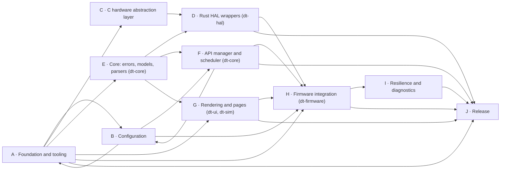
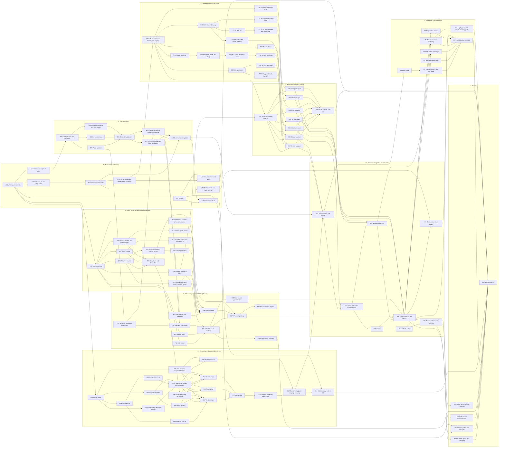

# ESP32 Desktop Terminal — Implementation Plan

| | |
|---|---|
| Status | Draft v0.2 |
| Date | 2026-11-17 |
| Related | [Requirements](Requirements.md) · [Architecture](Architecture.md) |

## 1. How this plan is organised

The work is split into 103 tasks (58 small, 45 medium). The tasks form a directed acyclic graph: each task lists the tasks it depends on, and a task can start as soon as all of those are done. There are no phases or milestones to wait for; anything whose dependencies are met can be picked up, in any order and in parallel.

Each task is one reviewable change:

- **Depends on** — tasks that must be finished first. Only direct dependencies are listed.
- **Unblocks** — tasks that list this one as a dependency.
- **Satisfies** — requirement IDs from [Requirements](Requirements.md) (the `REQ-` prefix is omitted).
- **Size** — **S**: up to about half a day. **M**: one to two days. Nothing is larger; a task that grows beyond M should be split.
- **Where** — **host**: done and verified on a PC. **device**: needs the board on the bench.
- **Done when** — the check that closes the task.

Task IDs are a workstream letter and a number. The number is only a name; the dependencies give the order.

| Stream | Scope | Tasks |
|---|---|---|
| A | Foundation and tooling | 9 |
| B | Configuration | 8 |
| C | C hardware abstraction layer | 15 |
| D | Rust HAL wrappers (dt-hal) | 9 |
| E | Core: errors, models, parsers (dt-core) | 12 |
| F | API manager and scheduler (dt-core) | 11 |
| G | Rendering and pages (dt-ui, dt-sim) | 18 |
| H | Firmware integration (dt-firmware) | 8 |
| I | Resilience and diagnostics | 8 |
| J | Release | 5 |

Two tasks are optional and nothing depends on them: F10 (Manual refresh request), J04 (Partial or fast refresh evaluation).

## 2. Workstream graph

How the streams feed each other. Stream G (rendering) and most of E and F need no hardware, so they can proceed in parallel with the C HAL from the first day.



## 3. Full task graph

Dashed boxes are optional tasks.



## 4. Parallel waves

A topological layering of the graph: every task in a wave depends only on tasks in earlier waves. This shows the earliest point at which each task can start, not a schedule. Tasks within a wave are independent of each other.

| Wave | Tasks that can start |
|---|---|
| 1 | A01 |
| 2 | A02, A03, A07, E01, G01 |
| 3 | A04, B01, E02, E03, E04, E05, E12, F02, F03, G02, G03, G04, G07 |
| 4 | A05, A06, B02, B03, B04, E06, E07, E08, E10, E11, G05, G06, G09 |
| 5 | A08, B05, C01, E09, F11, G08, G10 |
| 6 | B06, B07, C02, C05, C09, C10, C15, D01, G11, G12, G13, G16 |
| 7 | B08, C03, C04, C06, C11, C12, C14, D04, D09, F01, F04, G14 |
| 8 | A09, C07, C13, D02, D05, D07, F05, F06, G15 |
| 9 | C08, D06, F07, F08, F09, G17 |
| 10 | D03, F10, G18 |
| 11 | D08, H01 |
| 12 | H02, I01 |
| 13 | H03, H05, I02 |
| 14 | H04, H06, I04 |
| 15 | H07, H08, I03, I05, I06, J02 |
| 16 | I07, I08, J01, J03, J04 |
| 17 | J05 |

Tasks with no dependencies (start here): A01.

## 5. Critical path

The longest dependency chain, weighting S as 1 and M as 2 (total 27). Delay on any of these tasks delays the finish; everything else has slack.

```
A01 → A03 → A04 → A06 → C01 → C05 → C06 → C07 → C08 → D03 → H01 → H02 → H05 → H06 → I06 → I08 → J05
```

The chain runs through the build-system spike, the display driver and device integration, which is why A04, A06 and the first working panel init (C06) are worth doing first.

## 6. Tasks

### Stream A — Foundation and tooling

#### A01 — Workspace skeleton

- **Depends on:** nothing
- **Unblocks:** A02, A03, A07, E01, G01
- **Satisfies:** LANG-01, TEST-01
- **Size:** S · **Where:** host
- **Change:** Cargo workspace with empty `dt-config`, `dt-core`, `dt-ui`, `dt-sim` crates; base `.gitignore`; README outline.
- **Done when:** `cargo build` and `cargo test` pass on a PC.

#### A02 — Secret and AI ignore rules

- **Depends on:** A01
- **Unblocks:** B01
- **Satisfies:** CFG-03
- **Size:** S · **Where:** host
- **Change:** Git-ignore `config/secrets.toml` and `config/user.toml`. Add a `Read` deny rule for the secrets file to `.claude/settings.json`, plus ignore files for other AI tools.
- **Done when:** A dummy `config/secrets.toml` does not show in `git status`, and Claude Code refuses to read it.

#### A03 — Toolchain pin and setup guide

- **Depends on:** A01
- **Unblocks:** A04
- **Satisfies:** LANG-01, MAINT-02
- **Size:** S · **Where:** host
- **Change:** `rust-toolchain.toml` (esp channel), `.cargo/config.toml` (Xtensa ESP-IDF target, flash runner, pinned ESP-IDF version). `docs/Setup.md` listing the tools to install.
- **Done when:** Following `docs/Setup.md` on a clean machine yields a working toolchain.

#### A04 — Firmware hello-world

- **Depends on:** A03
- **Unblocks:** A05, A06, B08
- **Satisfies:** HW-01, LANG-01
- **Size:** M · **Where:** device
- **Change:** `dt-firmware` binary crate on `esp-idf-sys` with `sdkconfig.defaults`. Logs one line per second.
- **Done when:** Flashed to the driver board; the log line appears on the serial monitor.

#### A05 — Partition table and flash settings

- **Depends on:** A04
- **Unblocks:** H07
- **Satisfies:** HW-05, PERF-03, ERR-08
- **Size:** S · **Where:** device
- **Change:** `partitions.csv` with NVS, PHY and one factory application slot; 4 MB flash size; no OTA, no secure boot, no flash encryption.
- **Done when:** Device boots with the new table; boot log shows the expected partitions.

#### A06 — C HAL component skeleton and FFI spike

- **Depends on:** A04
- **Unblocks:** A08, C01
- **Satisfies:** LANG-02, LANG-03
- **Size:** M · **Where:** device
- **Change:** `hal/` ESP-IDF component with one function, `hal_version()`. Register it as an extra component so `bindgen` generates bindings. New `dt-hal` crate calls it. This retires the main build-system risk.
- **Done when:** The firmware prints the version string returned from C.

#### A07 — Host CI

- **Depends on:** A01
- **Unblocks:** A08, A09, G18
- **Satisfies:** TEST-03
- **Size:** S · **Where:** host
- **Change:** CI workflow: `cargo fmt --check`, `cargo clippy -D warnings`, `cargo test` for the host crates.
- **Done when:** Workflow is green on a pull request.

#### A08 — Unsafe-confinement gate

- **Depends on:** A06, A07
- **Unblocks:** J05
- **Satisfies:** LANG-03
- **Size:** S · **Where:** host
- **Change:** `#![forbid(unsafe_code)]` in every crate except `dt-hal`. CI step that fails if `unsafe` appears outside `crates/dt-hal`.
- **Done when:** Adding an `unsafe` block to `dt-core` fails CI.

#### A09 — Firmware CI build

- **Depends on:** A07, B08
- **Unblocks:** J02
- **Satisfies:** TEST-03, CFG-08
- **Size:** M · **Where:** host
- **Change:** CI job that installs the esp toolchain and builds the firmware with the example config (`DT_ALLOW_EXAMPLE_CONFIG=1`).
- **Done when:** Firmware build is green in CI without any real secrets.

### Stream B — Configuration

#### B01 — Config formats and templates

- **Depends on:** A02
- **Unblocks:** B02, B03, B04
- **Satisfies:** CFG-01, CFG-02, CFG-04, CFG-05, NEWS-01, NEWS-02, FIN-01, FIN-02, WX-05
- **Size:** M · **Where:** host
- **Change:** Write `config/api.toml`, `config/user.example.toml` and `config/secrets.example.toml`, fully commented, with the default providers, endpoints, topics and instruments, and the researched limits from Requirements §12.1.
- **Done when:** The three files exist and a reader can fill them in without other documentation.

#### B02 — Parse `api.toml`

- **Depends on:** B01
- **Unblocks:** B05, F11
- **Satisfies:** CFG-04, CFG-05, API-04
- **Size:** S · **Where:** host
- **Change:** `dt-config`: serde types for providers, auth method, limit windows (calls per minute/day/month), utilisation, and endpoints (path, parameters, weight, minimum interval, maximum staleness, response-size cap).
- **Done when:** Unit test parses the committed `api.toml`.

#### B03 — Parse `user.toml`

- **Depends on:** B01
- **Unblocks:** B05
- **Satisfies:** CFG-01, NEWS-02, FIN-02, FIN-06, WX-05
- **Size:** S · **Where:** host
- **Change:** `dt-config`: serde types for location, units, time zone, news topics (title + parameters) and instruments (label + ticker).
- **Done when:** Unit test parses `user.example.toml`.

#### B04 — Parse `secrets.toml` and `Secret` type

- **Depends on:** B01
- **Unblocks:** B05
- **Satisfies:** CFG-02, CFG-07
- **Size:** S · **Where:** host
- **Change:** `dt-config`: Wi-Fi credentials and per-provider keys, held in a `Secret` newtype whose `Debug`/`Display` print `***`.
- **Done when:** Unit test: formatting a parsed secrets struct never contains the key text.

#### B05 — Cross-file validation

- **Depends on:** B02, B03, B04
- **Unblocks:** B06, B07
- **Satisfies:** CFG-06, ERR-03
- **Size:** M · **Where:** host
- **Change:** Validate across the three files: https-only URLs, every topic/instrument maps to a defined endpoint, every provider has a key, placeholder keys rejected, counts within limits. Each error names file, key and fix.
- **Done when:** One unit test per rule, asserting on the message text.

#### B06 — Derived-schedule check at build time

- **Depends on:** B05, F11
- **Unblocks:** B08
- **Satisfies:** API-07, API-04
- **Size:** S · **Where:** host
- **Change:** Run the schedule derivation on the validated config; print a table of interval and calls per day for every job; fail if any interval exceeds its `max_staleness_s`.
- **Done when:** Unit tests: default config passes and prints the table; twelve news topics fail with a message showing the arithmetic.

#### B07 — Static config types and code generation

- **Depends on:** B05
- **Unblocks:** B08, F01, F04
- **Satisfies:** CFG-05, CFG-06
- **Size:** M · **Where:** host
- **Change:** `dt-core::config`: `'static` config types. `dt-config::generate()`: emit Rust source for a `static CONFIG` from validated config.
- **Done when:** Unit test: generated source for the example config compiles and round-trips the values.

#### B08 — Build-script integration

- **Depends on:** B06, B07, A04
- **Unblocks:** A09, H01
- **Satisfies:** CFG-06, CFG-08
- **Size:** S · **Where:** host
- **Change:** `dt-firmware/build.rs` calls `dt-config`, emits `CONFIG`, re-runs when config changes. Missing `secrets.toml` stops the build with instructions unless `DT_ALLOW_EXAMPLE_CONFIG=1`.
- **Done when:** Firmware builds with real config; deleting `secrets.toml` gives the instructive error.

### Stream C — C hardware abstraction layer

#### C01 — HAL conventions: errors, pins, logging

- **Depends on:** A06
- **Unblocks:** C02, C05, C09, C10, C15, D01
- **Satisfies:** LANG-04, HW-03, HW-04, HW-06, MAINT-01
- **Size:** S · **Where:** device
- **Change:** `hal_err.h` (`hal_err_t`, `hal_err_str`), `hal_pins.h` (display pins from `Pins.md`; buttons on GPIO16-19; a comment listing GPIO0, 2, 4, 12 as reserved), umbrella `hal.h`, and a header comment stating the HAL rules.
- **Done when:** Component builds; `hal_err_str` covers every code.

#### C02 — `hal_sys` basics

- **Depends on:** C01
- **Unblocks:** C03, C04
- **Satisfies:** ERR-07
- **Size:** S · **Where:** device
- **Change:** Uptime, free/minimum-free heap, reset reason, restart.
- **Done when:** Values print correctly from the firmware.

#### C03 — `hal_sys` retained memory

- **Depends on:** C02
- **Unblocks:** D02
- **Satisfies:** ERR-06
- **Size:** S · **Where:** device
- **Change:** A small block in RTC no-init memory with magic and CRC; read and write functions. Invalid CRC reads back as empty.
- **Done when:** A counter survives `hal_sys_restart()` and resets after a power cycle.

#### C04 — `hal_sys` watchdog

- **Depends on:** C02
- **Unblocks:** D02
- **Satisfies:** ERR-05
- **Size:** S · **Where:** device
- **Change:** Register the calling task with the task watchdog; feed function.
- **Done when:** A task that stops feeding causes a reset whose reason reads as watchdog.

#### C05 — Display transport

- **Depends on:** C01
- **Unblocks:** C06
- **Satisfies:** HW-02, HW-03
- **Size:** M · **Where:** device
- **Change:** SPI bus and GPIO setup on the documented pins; hardware reset; send-command and send-data; BUSY wait with timeout.
- **Done when:** Reset pulses and SPI traffic happen without error; BUSY wait returns `HAL_ERR_TIMEOUT` with the panel unplugged.

#### C06 — Panel init, power and sleep

- **Depends on:** C05
- **Unblocks:** C07
- **Satisfies:** HW-02, DISP-01
- **Size:** M · **Where:** device
- **Change:** Set SW1 as Waveshare specifies for the 7.5-inch panel (OQ-8) and run the vendor demo once as a known-good reference. Implement the 800×480 black/white init sequence, power on/off and deep sleep.
- **Done when:** Init completes with BUSY behaving as the datasheet describes; sleep and re-init work repeatedly.

#### C07 — Full-frame show and clear

- **Depends on:** C06
- **Unblocks:** C08
- **Satisfies:** HW-02
- **Size:** M · **Where:** device
- **Change:** `hal_display_show(frame, len)`: wake, transfer, full refresh, sleep. `hal_display_clear()`.
- **Done when:** A test pattern (border, checkerboard, corner markers) displays with correct orientation and polarity.

#### C08 — Display hardening

- **Depends on:** C07
- **Unblocks:** D03
- **Satisfies:** ERR-01, ERR-02
- **Size:** S · **Where:** device
- **Change:** Mutex around display operations; length validation; after any timeout the next call re-initialises the panel; no aborts.
- **Done when:** Unplugging and re-plugging the panel between refreshes recovers without a reset.

#### C09 — Buttons driver

- **Depends on:** C01
- **Unblocks:** D04
- **Satisfies:** HW-04, UX-02
- **Size:** M · **Where:** device
- **Change:** Four active-low inputs on GPIO16-19 with internal pull-ups; interrupt → debounce → queue; press and long-press events; `hal_buttons_wait` with timeout.
- **Done when:** Each button yields exactly one event per press, and a long-press event when held.

#### C10 — Wi-Fi station bring-up

- **Depends on:** C01
- **Unblocks:** C11, C12, C14
- **Satisfies:** API-01
- **Size:** M · **Where:** device
- **Change:** Init NVS, netif and event loop; connect in station mode; reconnect automatically with backoff; `hal_wifi_start`, `hal_wifi_status`.
- **Done when:** Device obtains an IP address and reconnects after the access point is power-cycled.

#### C11 — Wi-Fi status and failure reasons

- **Depends on:** C10
- **Unblocks:** D05
- **Satisfies:** ERR-03
- **Size:** S · **Where:** device
- **Change:** `hal_wifi_wait_connected(timeout)`; map disconnect reasons to `HAL_ERR_WIFI_AUTH`, `HAL_ERR_WIFI_NO_AP`, `HAL_ERR_WIFI_DISCONNECTED`; expose RSSI.
- **Done when:** Wrong password and wrong SSID each report the right error code.

#### C12 — HTTPS GET

- **Depends on:** C10
- **Unblocks:** C13
- **Satisfies:** API-08, NEWS-05
- **Size:** M · **Where:** device
- **Change:** `hal_http_get` on `esp_http_client` with the certificate bundle: custom headers, timeout, caller buffer, status code, truncation flag.
- **Done when:** Fetches a known HTTPS URL; a too-small buffer sets `truncated` instead of overflowing.

#### C13 — HTTP error mapping and `Retry-After`

- **Depends on:** C12
- **Unblocks:** D06
- **Satisfies:** ERR-03, API-05
- **Size:** S · **Where:** device
- **Change:** Map failures to `HAL_ERR_DNS`, `HAL_ERR_CONNECT`, `HAL_ERR_TLS`, `HAL_ERR_TIMEOUT`; capture `Retry-After`; ensure the URL is never logged.
- **Done when:** Bad host name, closed port and bad certificate each give the right code.

#### C14 — Time: SNTP and time zone

- **Depends on:** C10
- **Unblocks:** D07
- **Satisfies:** UX-06, WX-05
- **Size:** S · **Where:** device
- **Change:** Start SNTP, apply a POSIX TZ string; `hal_time_is_synced`, `hal_time_now`, `hal_time_utc_offset`.
- **Done when:** Correct local time is logged after connecting; `is_synced` is false before.

#### C15 — `hal_store`: persistent blobs

- **Depends on:** C01
- **Unblocks:** D09
- **Satisfies:** API-10
- **Size:** S · **Where:** device
- **Change:** `hal_store_get` / `hal_store_set` on NVS. A missing or corrupt entry reads as empty.
- **Done when:** A value survives a power cycle; erasing NVS reads back as empty without error.

### Stream D — Rust HAL wrappers (dt-hal)

#### D01 — FFI plumbing and `HalError`

- **Depends on:** C01, E02
- **Unblocks:** D02, D03, D04, D05, D06, D07, D09
- **Satisfies:** LANG-03
- **Size:** S · **Where:** device
- **Change:** Import the generated bindings; convert `hal_err_t` to `HalError` and into `AppError`; lint requiring a `SAFETY:` comment on each unsafe block.
- **Done when:** Crate builds for the target; conversion covers every HAL code.

#### D02 — System wrapper

- **Depends on:** D01, C03, C04
- **Unblocks:** D08, H01
- **Satisfies:** ERR-05, ERR-06, ERR-07
- **Size:** S · **Where:** device
- **Change:** `HalSystem` implementing `System`: heap, uptime, reset reason, restart, watchdog, retained memory.
- **Done when:** Smoke-tested from the firmware.

#### D03 — Display wrapper

- **Depends on:** D01, C08
- **Unblocks:** D08, H01
- **Satisfies:** HW-02
- **Size:** S · **Where:** device
- **Change:** `EinkDisplay` implementing `Display`; takes a frame slice of exactly the right length.
- **Done when:** A Rust-generated pattern shows on the panel.

#### D04 — Buttons wrapper

- **Depends on:** D01, C09
- **Unblocks:** D08, H02
- **Satisfies:** UX-02
- **Size:** S · **Where:** device
- **Change:** `HalButtons` implementing `Buttons`; typed `ButtonEvent`.
- **Done when:** Presses are logged from Rust.

#### D05 — Wi-Fi wrapper

- **Depends on:** D01, C11
- **Unblocks:** D08, H05
- **Satisfies:** API-01
- **Size:** S · **Where:** device
- **Change:** `HalWifi` implementing `Wifi`; typed status and failure reason.
- **Done when:** Connect and status are logged from Rust.

#### D06 — HTTP wrapper

- **Depends on:** D01, C13
- **Unblocks:** D08, H06
- **Satisfies:** API-08
- **Size:** S · **Where:** device
- **Change:** `HalHttp` implementing `HttpClient`; borrows the caller's buffer and returns the filled slice.
- **Done when:** A GET from Rust returns status and body.

#### D07 — Clock wrapper

- **Depends on:** D01, C14
- **Unblocks:** D08, H05
- **Satisfies:** UX-06
- **Size:** S · **Where:** device
- **Change:** `HalClock` implementing `Clock`.
- **Done when:** Local time is logged from Rust.

#### D08 — On-device HAL self-test

- **Depends on:** D02, D03, D04, D05, D06, D07, D09
- **Unblocks:** J05
- **Satisfies:** TEST-01, MAINT-02
- **Size:** M · **Where:** device
- **Change:** Firmware feature `hal-selftest` that runs each wrapper in turn and prints pass/fail per module.
- **Done when:** All modules pass on the bench; the procedure is described in `docs/Setup.md`.

#### D09 — Storage wrapper

- **Depends on:** D01, C15
- **Unblocks:** D08, H06
- **Satisfies:** API-10
- **Size:** S · **Where:** device
- **Change:** `HalStore` implementing `Storage`.
- **Done when:** A blob written from Rust is read back after a power cycle.

### Stream E — Core: errors, models, parsers (dt-core)

#### E01 — Error taxonomy

- **Depends on:** A01
- **Unblocks:** E02, E03, E04, E05, E12, F02, F03
- **Satisfies:** ERR-03
- **Size:** S · **Where:** host
- **Change:** `AppError` with code, category, message and hint; `Display` formatting; the code list as an enum.
- **Done when:** Unit tests on formatting; every code has a hint.

#### E02 — Platform traits and fakes

- **Depends on:** E01
- **Unblocks:** D01, F05, F06
- **Satisfies:** TEST-01, LANG-04
- **Size:** M · **Where:** host
- **Change:** `dt-core::platform`: `Display`, `Buttons`, `Wifi`, `HttpClient`, `Clock`, `System`, `Storage` traits. In-memory fakes behind a `testing` feature (scripted HTTP responses, settable clock).
- **Done when:** Fakes are usable from a test in another crate.

#### E03 — Weather models

- **Depends on:** E01
- **Unblocks:** E06, E07, E08
- **Satisfies:** DM-03, WX-01, WX-02, WX-03
- **Size:** S · **Where:** host
- **Change:** `Current`, `HourlyPoint`, `DailySummary`, `Weather`, and a provider-neutral `Condition` enum.
- **Done when:** Types compile, with constructors used by tests.

#### E04 — News models

- **Depends on:** E01
- **Unblocks:** E06, E10
- **Satisfies:** DM-03, NEWS-04
- **Size:** S · **Where:** host
- **Change:** `Headline` (title, source, published time) and `NewsTopic`, with caps on count and title length.
- **Done when:** Unit test: caps are enforced.

#### E05 — Finance models and history buffer

- **Depends on:** E01
- **Unblocks:** E06, E11
- **Satisfies:** DM-03, FIN-04, FIN-05
- **Size:** S · **Where:** host
- **Change:** `Quote` and a fixed-capacity ring buffer of sampled prices for the trend chart.
- **Done when:** Unit test: ring buffer overwrites oldest and iterates in order.

#### E06 — Slot, Store and Snapshot

- **Depends on:** E03, E04, E05
- **Unblocks:** F07, G10
- **Satisfies:** DM-01, DM-02, ERR-04
- **Size:** M · **Where:** host
- **Change:** `Slot<T>` (data, fetched-at, last error). `Store` with `apply(update)` returning affected pages, and `snapshot()`. A failed update keeps the old data.
- **Done when:** Unit tests: success replaces data; failure keeps data and records the error; affected pages are correct.

#### E07 — OpenWeatherMap current-weather parser

- **Depends on:** E03
- **Unblocks:** F06
- **Satisfies:** WX-03, WX-04, API-03
- **Size:** S · **Where:** host
- **Change:** Parse `/weather` JSON into `Current`; map provider condition codes to `Condition`. Recorded fixture.
- **Done when:** Fixture test passes; unknown fields are ignored; missing optional fields do not fail.

#### E08 — OpenWeatherMap forecast parser

- **Depends on:** E03
- **Unblocks:** E09
- **Satisfies:** WX-02, WX-04, WX-06
- **Size:** S · **Where:** host
- **Change:** Parse `/forecast` JSON into 3-hour `HourlyPoint`s. Recorded fixture.
- **Done when:** Fixture test yields 40 points with correct times and values.

#### E09 — Daily aggregation

- **Depends on:** E08
- **Unblocks:** F06
- **Satisfies:** WX-01, WX-06
- **Size:** M · **Where:** host
- **Change:** Group 3-hour points by local day: min/max temperature, dominant condition, maximum precipitation probability.
- **Done when:** Unit tests including a time-zone boundary and a partial first day.

#### E10 — NewsAPI parser and title clean-up

- **Depends on:** E04
- **Unblocks:** F06
- **Satisfies:** NEWS-03, NEWS-04, API-03
- **Size:** M · **Where:** host
- **Change:** Parse `top-headlines` JSON; drop removed articles; strip the trailing ' - Source' from titles; transliterate characters outside Latin-1.
- **Done when:** Fixture test; table-driven test of the transliteration using real headlines.

#### E11 — Finnhub quote parser

- **Depends on:** E05
- **Unblocks:** F06
- **Satisfies:** FIN-03, FIN-06, API-03
- **Size:** S · **Where:** host
- **Change:** Parse `/quote` JSON into `Quote`. Treat an all-zero response as 'unknown symbol'.
- **Done when:** Fixture tests for a valid quote and an unknown symbol.

#### E12 — HTTP and provider error classification

- **Depends on:** E01
- **Unblocks:** F06
- **Satisfies:** ERR-03
- **Size:** S · **Where:** host
- **Change:** Map transport errors, HTTP status (401, 403, 404, 429, 5xx) and provider error bodies to `AppError`s with specific hints.
- **Done when:** Table-driven unit test: one row per case, asserting code and hint.

### Stream F — API manager and scheduler (dt-core)

#### F01 — URL builder and redaction

- **Depends on:** B07
- **Unblocks:** F06
- **Satisfies:** CFG-05, CFG-07
- **Size:** S · **Where:** host
- **Change:** Build a request (URL + headers) from provider, endpoint, parameters and secret, with percent-encoding. A redacted form for logging.
- **Done when:** Unit tests for query-key and header-key auth; the redacted form never contains the secret.

#### F02 — Rate limiter

- **Depends on:** E01
- **Unblocks:** F05
- **Satisfies:** API-02
- **Size:** M · **Where:** host
- **Change:** One counter per configured limit window (minute, day, month) per provider: `try_acquire(now)` and `next_available(now)`. State is serialisable.
- **Done when:** Unit tests with a fake clock: limits are never exceeded; windows roll over.

#### F03 — Backoff policy

- **Depends on:** E01
- **Unblocks:** F05
- **Satisfies:** API-05
- **Size:** S · **Where:** host
- **Change:** Exponential delay with jitter, capped at the job interval; `Retry-After` override; immediate maximum delay for permanent errors.
- **Done when:** Unit tests for growth, cap, override and reset on success.

#### F04 — Job table from config

- **Depends on:** B07, F11
- **Unblocks:** F05
- **Satisfies:** API-01, API-04
- **Size:** S · **Where:** host
- **Change:** Expand `CONFIG` into jobs (current weather, forecast, one per topic, one per instrument) and attach the derived interval and phase to each.
- **Done when:** Unit test: the example config yields the expected job list.

#### F05 — Scheduler state machine

- **Depends on:** F02, F03, F04, E02
- **Unblocks:** F07, F08, F09
- **Satisfies:** API-01, API-02, API-09
- **Size:** M · **Where:** host
- **Change:** `next(now)` returns `Run(job)` or `Wait(duration)`; `report(job, outcome, now)` updates due times. Runs each job at its derived interval and phase; every run, including retries, must acquire from the rate limiter.
- **Done when:** Unit tests with a fake clock: over a simulated week each provider's calls are evenly spaced, no window is ever exceeded, and a failed job backs off and recovers.

#### F06 — Fetch executor

- **Depends on:** F01, E02, E07, E09, E10, E11, E12
- **Unblocks:** F07
- **Satisfies:** API-03, NEWS-05
- **Size:** M · **Where:** host
- **Change:** Run one job: build request, call `HttpClient`, classify status and errors, parse, produce an `Update`. Sends `User-Agent`.
- **Done when:** Unit tests with the fake HTTP client for success, each error class and truncation.

#### F07 — API manager loop

- **Depends on:** F05, F06, E06
- **Unblocks:** F10, H06
- **Satisfies:** API-01, API-06
- **Size:** M · **Where:** host
- **Change:** The blocking loop: wait for connectivity, ask the scheduler, execute, apply to the store, notify the UI channel.
- **Done when:** Component test: simulated hours with scripted responses leave the store in the expected state and the call log within limits.

#### F08 — Market-hours throttling

- **Depends on:** F05
- **Unblocks:** J05
- **Satisfies:** FIN-03, API-02
- **Size:** S · **Where:** host
- **Change:** Use a slower interval for quote jobs outside US market hours (weekday and time-of-day check; no holiday calendar).
- **Done when:** Unit tests across open, close and a weekend.

#### F09 — Rate-counter persistence

- **Depends on:** F05
- **Unblocks:** H06
- **Satisfies:** API-02, API-10
- **Size:** S · **Where:** host
- **Change:** Save rate-limiter state through `Storage` after each call on providers with day or month windows; restore at start. With no synchronised clock, treat saved counts as still inside their window.
- **Done when:** Unit tests with the fake `Storage`: a restart mid-day does not reset the daily count; corrupt saved state starts from a conservative default.

#### F10 — Manual refresh request *(optional)*

- **Depends on:** F07
- **Unblocks:** nothing
- **Satisfies:** API-02
- **Size:** S · **Where:** host
- **Change:** `request_refresh(page)` marks that page's jobs due, still subject to rate limits.
- **Done when:** Unit test: jobs run early when budget allows and are refused when it does not.

#### F11 — Schedule derivation from limits

- **Depends on:** B02
- **Unblocks:** B06, F04
- **Satisfies:** API-04, API-09
- **Size:** M · **Where:** host
- **Change:** Pure function, shared by the build and the device: from limit windows, utilisation, job weights and floors, compute each job's interval and a staggered phase (Requirements §6.1).
- **Done when:** Unit tests: 100/day over 4 equal jobs gives 64 min each and 16 min between calls; adding a job lengthens all; a floor overrides a generous limit; the binding window is the slowest one; weights skew the split.

### Stream G — Rendering and pages (dt-ui, dt-sim)

#### G01 — Frame buffer

- **Depends on:** A01
- **Unblocks:** G02, G03, G04, G07
- **Satisfies:** HW-02, DM-01
- **Size:** S · **Where:** host
- **Change:** `FrameBuffer`: 800×480, 1 bit per pixel, panel byte order, `embedded-graphics` `DrawTarget`, content hash.
- **Done when:** Unit tests for pixel addressing at corners and for hash changes.

#### G02 — Simulator and snapshot harness

- **Depends on:** G01
- **Unblocks:** G11, G12, G13, G16
- **Satisfies:** TEST-02
- **Size:** M · **Where:** host
- **Change:** `dt-sim`: write a `FrameBuffer` to PNG. Test helper that compares against a stored golden image and can update it.
- **Done when:** A sample frame round-trips; a one-pixel change fails the comparison.

#### G03 — Typography and text helpers

- **Depends on:** G01
- **Unblocks:** G08
- **Satisfies:** UX-05
- **Size:** M · **Where:** host
- **Change:** Choose the font set and type scale. Helpers: measure, align, truncate with ellipsis, wrap to at most N lines.
- **Done when:** Unit tests for wrap and truncation; a specimen image in the simulator.

#### G04 — Icon pipeline

- **Depends on:** G01
- **Unblocks:** G05, G06
- **Satisfies:** UX-04
- **Size:** M · **Where:** host
- **Change:** Convert source images in `assets/icons` to 1-bit bitmaps at build time; `Icon` enum and `draw_icon`.
- **Done when:** One sample icon renders in the simulator.

#### G05 — Weather icon set

- **Depends on:** G04
- **Unblocks:** G11
- **Satisfies:** UX-04
- **Size:** M · **Where:** host
- **Change:** Icons for every `Condition`, day and night where it matters, in a large and a small size.
- **Done when:** A contact sheet of all icons renders in the simulator.

#### G06 — Interface icon set

- **Depends on:** G04
- **Unblocks:** G08
- **Satisfies:** UX-04, UX-06
- **Size:** S · **Where:** host
- **Change:** Wi-Fi strength levels and off, warning, stale, up/down arrows, page glyphs.
- **Done when:** Contact sheet renders in the simulator.

#### G07 — Layout primitives

- **Depends on:** G01
- **Unblocks:** G08, G09
- **Satisfies:** UX-05
- **Size:** S · **Where:** host
- **Change:** `Rect` splitting (rows, columns, insets), dividers, titled panel.
- **Done when:** Unit tests on the geometry.

#### G08 — Page frame: header and navigation

- **Depends on:** G03, G06, G07
- **Unblocks:** G11, G12, G13, G16
- **Satisfies:** UX-06
- **Size:** M · **Where:** host
- **Change:** Header (title, date, status glyphs) and footer (four tabs with the active one highlighted, updated time).
- **Done when:** Golden image of an empty framed page for each of the four pages.

#### G09 — Chart widgets

- **Depends on:** G07
- **Unblocks:** G11, G13
- **Satisfies:** UX-04, FIN-05
- **Size:** M · **Where:** host
- **Change:** Sparkline with auto-scaling; temperature line/bar strip for the hourly forecast.
- **Done when:** Golden images for normal data, flat data and fewer than two points.

#### G10 — View models and formatting

- **Depends on:** E06
- **Unblocks:** G11, G12, G13
- **Satisfies:** DM-01
- **Size:** M · **Where:** host
- **Change:** Functions from `Snapshot` to per-page view models: units, number formats, relative times, freshness state.
- **Done when:** Unit tests on formatting, with no rendering involved.

#### G11 — Weather page

- **Depends on:** G05, G08, G09, G10, G02
- **Unblocks:** G14
- **Satisfies:** WX-01, WX-02, WX-03, UX-04
- **Size:** M · **Where:** host
- **Change:** Current conditions block, hourly strip with chart, five-day row.
- **Done when:** Golden image from fixture data.

#### G12 — News page

- **Depends on:** G08, G10, G02
- **Unblocks:** G14
- **Satisfies:** NEWS-01, NEWS-04
- **Size:** M · **Where:** host
- **Change:** A section per topic with wrapped headlines, source and age.
- **Done when:** Golden image from fixture data, including very long titles.

#### G13 — Finance page

- **Depends on:** G08, G09, G10, G02
- **Unblocks:** G14
- **Satisfies:** FIN-01, FIN-04, FIN-05
- **Size:** M · **Where:** host
- **Change:** A card per instrument: label, price, change arrow, percent, day range, sparkline.
- **Done when:** Golden image from fixture data, with rising and falling instruments.

#### G14 — Home page

- **Depends on:** G11, G12, G13
- **Unblocks:** G15
- **Satisfies:** HOME-01, HOME-02
- **Size:** M · **Where:** host
- **Change:** Three highlight panels reusing the page components: weather now and today, top headline per topic, quotes strip.
- **Done when:** Golden image from fixture data.

#### G15 — Loading, stale and error states

- **Depends on:** G14
- **Unblocks:** G17
- **Satisfies:** ERR-04, ERR-03, DM-02
- **Size:** M · **Where:** host
- **Change:** Per-panel placeholders for 'no data yet' and 'never succeeded' (message and hint); stale marker with age on panels showing old data.
- **Done when:** Golden images for each state on each page.

#### G16 — System screens

- **Depends on:** G08, G02
- **Unblocks:** G17
- **Satisfies:** UX-07, ERR-07
- **Size:** M · **Where:** host
- **Change:** Splash with progress text, safe-mode screen, diagnostics screen.
- **Done when:** Golden images for each.

#### G17 — Render entry point and page mapping

- **Depends on:** G15, G16
- **Unblocks:** G18, H01
- **Satisfies:** UX-01, UX-02, DM-01
- **Size:** S · **Where:** host
- **Change:** `Page` enum, button-to-page mapping, and `render(page, snapshot, status, now, frame)`.
- **Done when:** Unit test of the mapping; the simulator CLI renders any page by name.

#### G18 — Golden-image suite in CI

- **Depends on:** G17, A07
- **Unblocks:** J05
- **Satisfies:** TEST-02, TEST-03
- **Size:** S · **Where:** host
- **Change:** Run all page × state goldens in CI; document how to update them.
- **Done when:** CI fails on an unintended visual change.

### Stream H — Firmware integration (dt-firmware)

#### H01 — Boot skeleton and splash

- **Depends on:** D02, D03, G17, B08
- **Unblocks:** H02, I01
- **Satisfies:** UX-07
- **Size:** M · **Where:** device
- **Change:** Boot sequence up to the display: system init, log reset reason, display init, draw the splash through `render`.
- **Done when:** Powering on shows the splash on the panel.

#### H02 — Event queue and buttons thread

- **Depends on:** H01, D04
- **Unblocks:** H03, H05
- **Satisfies:** UX-02, API-06
- **Size:** S · **Where:** device
- **Change:** `Event` enum and channel; a thread that turns HAL button events into `Event::Button`.
- **Done when:** Button events are logged by the main thread.

#### H03 — UI loop

- **Depends on:** H02
- **Unblocks:** H04, H06
- **Satisfies:** UX-01, UX-03, UX-09, DM-01
- **Size:** M · **Where:** device
- **Change:** Event loop: track the current page, take a snapshot, render, skip if the frame hash is unchanged, show.
- **Done when:** The four buttons switch between the four pages (showing empty states).

#### H04 — Refresh policy

- **Depends on:** H03
- **Unblocks:** H08, I08
- **Satisfies:** UX-08, UX-09, DISP-01, DISP-02, DISP-03
- **Size:** M · **Where:** device
- **Change:** Drain and coalesce button events after each refresh; minimum spacing for data-driven refreshes with deferral; forced refresh after 24 h. Put the timing logic in `dt-core` so it is unit-tested.
- **Done when:** Unit tests for the policy; on the device, rapid presses end on the last page pressed.

#### H05 — Network supervisor

- **Depends on:** H02, D05, D07
- **Unblocks:** H06, I04
- **Satisfies:** API-06, ERR-01
- **Size:** M · **Where:** device
- **Change:** Network thread: start Wi-Fi and time sync, publish `NetworkChanged` events. Boot does not wait for it.
- **Done when:** Header glyph follows Wi-Fi state; the device reaches Home with the access point off.

#### H06 — API manager on the device

- **Depends on:** H05, H03, F07, F09, D06, D09
- **Unblocks:** H07, H08, I03, I05, I06, J02
- **Satisfies:** API-01, API-03, API-10
- **Size:** M · **Where:** device
- **Change:** Run the API manager on the network thread with the real HTTP client, persistent storage for call counts, the shared store and the UI channel.
- **Done when:** Live weather, news and quotes appear on their pages; the serial log shows calls at the derived, evenly spaced times.

#### H07 — Memory and stack budget

- **Depends on:** H06, A05
- **Unblocks:** I08
- **Satisfies:** PERF-02, HW-05
- **Size:** M · **Where:** device
- **Change:** Allocate frame and HTTP buffers once; set thread stack sizes from measured high-water marks; log heap minimum periodically.
- **Done when:** Measured free heap during a TLS request meets the requirement; figures recorded in the architecture doc.

#### H08 — End-to-end check on hardware

- **Depends on:** H04, H06
- **Unblocks:** J01, J03, J04
- **Satisfies:** UX-01, HOME-01
- **Size:** S · **Where:** device
- **Change:** Walk through all four pages with live data and compare against the simulator output; fix discrepancies.
- **Done when:** All pages are correct and legible on the physical panel.

### Stream I — Resilience and diagnostics

#### I01 — Panic hook

- **Depends on:** H01
- **Unblocks:** I02
- **Satisfies:** ERR-05
- **Size:** S · **Where:** device
- **Change:** On panic: log, record code and location in retained memory, try to show an error screen, restart.
- **Done when:** A deliberate panic produces the log, the screen and a restart.

#### I02 — Boot-loop guard and safe mode

- **Depends on:** I01
- **Unblocks:** I08
- **Satisfies:** ERR-06, ERR-02
- **Size:** M · **Where:** device
- **Change:** Count consecutive abnormal restarts in retained memory; after three, enter safe mode (no network, diagnostics screen, any button or 15 minutes retries normal boot). Clear the count after 10 minutes of healthy uptime.
- **Done when:** A build that panics at start-up settles in safe mode instead of looping.

#### I03 — Watchdog integration

- **Depends on:** H06
- **Unblocks:** I08
- **Satisfies:** ERR-05
- **Size:** S · **Where:** device
- **Change:** UI and network threads register with and feed the watchdog; timeouts chosen above the longest legitimate block.
- **Done when:** An injected infinite loop in either thread causes a watchdog restart; normal operation never trips it.

#### I04 — Wi-Fi failure messages

- **Depends on:** H05
- **Unblocks:** I08
- **Satisfies:** ERR-03
- **Size:** S · **Where:** device
- **Change:** Turn Wi-Fi failure reasons into on-screen messages with hints, while reconnection continues.
- **Done when:** Wrong password and unknown network each show their own message.

#### I05 — Per-source error surfacing

- **Depends on:** H06
- **Unblocks:** I07, I08
- **Satisfies:** ERR-04, ERR-03, ERR-01
- **Size:** S · **Where:** device
- **Change:** Confirm slot errors reach the panels on the device: stale markers, error text, hints.
- **Done when:** With one invalid API key, that source shows its error and the others keep working.

#### I06 — Diagnostics screen

- **Depends on:** H06
- **Unblocks:** I08
- **Satisfies:** ERR-07
- **Size:** M · **Where:** device
- **Change:** Long press on button 1 opens diagnostics: version, uptime, reset reason, network, heap, job status, budget used.
- **Done when:** The screen shows live values and returns to Home on any press.

#### I07 — Log hygiene and troubleshooting guide

- **Depends on:** I05
- **Unblocks:** J05
- **Satisfies:** CFG-07, ERR-07, MAINT-02
- **Size:** S · **Where:** device
- **Change:** Consistent log tags and levels; a test that no log line contains a secret; `docs/Troubleshooting.md` with every error code.
- **Done when:** A captured log from a full session contains no secrets; every code in the enum is documented.

#### I08 — Fault injection and soak

- **Depends on:** I02, I03, I04, I05, I06, H04, H07
- **Unblocks:** J05
- **Satisfies:** REL-01, ERR-01, ERR-02
- **Size:** M · **Where:** device
- **Change:** Scripted checklist (access point off/on, bad key, DNS failure, panel unplugged, forced panics, repeated power cycling), then a 7-day unattended run.
- **Done when:** Checklist passes; no manual restart in 7 days; heap minimum stays flat; no provider limit exceeded (checked against the providers' usage dashboards).

### Stream J — Release

#### J01 — README: quick start and wiring

- **Depends on:** H08
- **Unblocks:** J05
- **Satisfies:** MAINT-02
- **Size:** S · **Where:** host
- **Change:** Build, configure and flash instructions; wiring table for the display and buttons; a photo or rendered page images.
- **Done when:** Someone new can go from clone to a working terminal using the README.

#### J02 — Release profile and size gate

- **Depends on:** H06, A09
- **Unblocks:** J05
- **Satisfies:** PERF-03
- **Size:** S · **Where:** host
- **Change:** Size-optimised release profile with LTO; CI step comparing image size to the partition.
- **Done when:** CI reports the image size and fails above 90 % of the partition.

#### J03 — Performance measurements

- **Depends on:** H08
- **Unblocks:** J05
- **Satisfies:** PERF-01, UX-08
- **Size:** S · **Where:** device
- **Change:** Measure render time per page and press-to-refresh latency; optimise if over budget.
- **Done when:** Measurements meet the requirements and are recorded.

#### J04 — Partial or fast refresh evaluation *(optional)*

- **Depends on:** H08
- **Unblocks:** nothing
- **Satisfies:** UX-08
- **Size:** M · **Where:** device
- **Change:** Test which refresh modes this panel revision supports (fast, partial); if any, propose a policy as a follow-up.
- **Done when:** A short written finding with a recommendation.

#### J05 — v1.0 acceptance

- **Depends on:** I08, J01, J02, J03, F08, G18, A08, D08, I07
- **Unblocks:** nothing
- **Satisfies:** REL-01
- **Size:** S · **Where:** device
- **Change:** Walk the requirements list and record the evidence for each one; close or re-file the open questions.
- **Done when:** Every v1 requirement is marked met, with a reference to its test or check.

## 7. Requirement coverage

Every requirement is addressed by at least one task. J05 verifies all of them at the end.

| Requirement | Tasks |
|---|---|
| REQ-HW-01 | A04 |
| REQ-HW-02 | C05, C06, C07, D03, G01 |
| REQ-HW-03 | C01, C05 |
| REQ-HW-04 | C01, C09 |
| REQ-HW-05 | A05, H07 |
| REQ-HW-06 | C01 |
| REQ-UX-01 | G17, H03, H08 |
| REQ-UX-02 | C09, D04, G17, H02 |
| REQ-UX-03 | H03 |
| REQ-UX-04 | G04, G05, G06, G09, G11 |
| REQ-UX-05 | G03, G07 |
| REQ-UX-06 | C14, D07, G06, G08 |
| REQ-UX-07 | G16, H01 |
| REQ-UX-08 | H04, J03, J04 |
| REQ-UX-09 | H03, H04 |
| REQ-HOME-01 | G14, H08 |
| REQ-HOME-02 | G14 |
| REQ-WX-01 | E03, E09, G11 |
| REQ-WX-02 | E03, E08, G11 |
| REQ-WX-03 | E03, E07, G11 |
| REQ-WX-04 | E07, E08 |
| REQ-WX-05 | B01, B03, C14 |
| REQ-WX-06 | E08, E09 |
| REQ-NEWS-01 | B01, G12 |
| REQ-NEWS-02 | B01, B03 |
| REQ-NEWS-03 | E10 |
| REQ-NEWS-04 | E04, E10, G12 |
| REQ-NEWS-05 | C12, F06 |
| REQ-FIN-01 | B01, G13 |
| REQ-FIN-02 | B01, B03 |
| REQ-FIN-03 | E11, F08 |
| REQ-FIN-04 | E05, G13 |
| REQ-FIN-05 | E05, G09, G13 |
| REQ-FIN-06 | B03, E11 |
| REQ-CFG-01 | B01, B03 |
| REQ-CFG-02 | B01, B04 |
| REQ-CFG-03 | A02 |
| REQ-CFG-04 | B01, B02 |
| REQ-CFG-05 | B01, B02, B07, F01 |
| REQ-CFG-06 | B05, B07, B08 |
| REQ-CFG-07 | B04, F01, I07 |
| REQ-CFG-08 | A09, B08 |
| REQ-API-01 | C10, D05, F04, F05, F07, H06 |
| REQ-API-02 | F02, F05, F08, F09, F10 |
| REQ-API-03 | E07, E10, E11, F06, H06 |
| REQ-API-04 | B02, B06, F04, F11 |
| REQ-API-05 | C13, F03 |
| REQ-API-06 | F07, H02, H05 |
| REQ-API-07 | B06 |
| REQ-API-08 | C12, D06 |
| REQ-API-09 | F05, F11 |
| REQ-API-10 | C15, D09, F09, H06 |
| REQ-DM-01 | E06, G01, G10, G17, H03 |
| REQ-DM-02 | E06, G15 |
| REQ-DM-03 | E03, E04, E05 |
| REQ-LANG-01 | A01, A03, A04 |
| REQ-LANG-02 | A06 |
| REQ-LANG-03 | A06, A08, D01 |
| REQ-LANG-04 | C01, E02 |
| REQ-ERR-01 | C08, H05, I05, I08 |
| REQ-ERR-02 | C08, I02, I08 |
| REQ-ERR-03 | B05, C11, C13, E01, E12, G15, I04, I05 |
| REQ-ERR-04 | E06, G15, I05 |
| REQ-ERR-05 | C04, D02, I01, I03 |
| REQ-ERR-06 | C03, D02, I02 |
| REQ-ERR-07 | C02, D02, G16, I06, I07 |
| REQ-ERR-08 | A05 |
| REQ-DISP-01 | C06, H04 |
| REQ-DISP-02 | H04 |
| REQ-DISP-03 | H04 |
| REQ-PERF-01 | J03 |
| REQ-PERF-02 | H07 |
| REQ-PERF-03 | A05, J02 |
| REQ-REL-01 | I08, J05 |
| REQ-TEST-01 | A01, E02, D08 |
| REQ-TEST-02 | G02, G18 |
| REQ-TEST-03 | A07, A09, G18 |
| REQ-MAINT-01 | C01 |
| REQ-MAINT-02 | A03, D08, I07, J01 |
